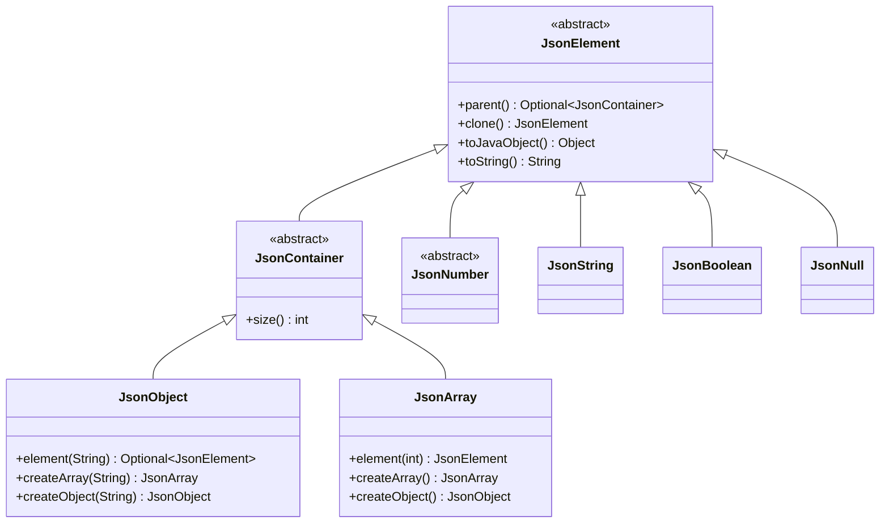
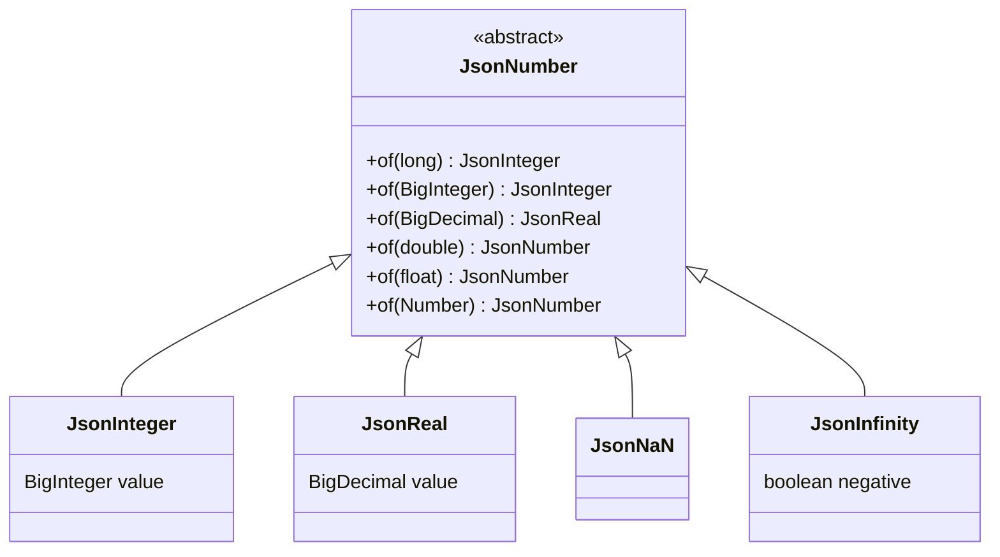
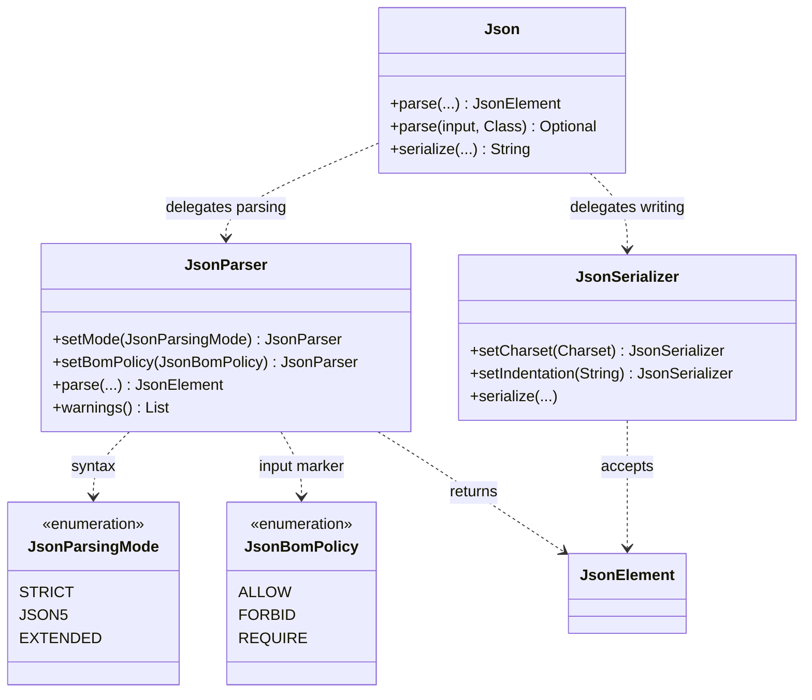
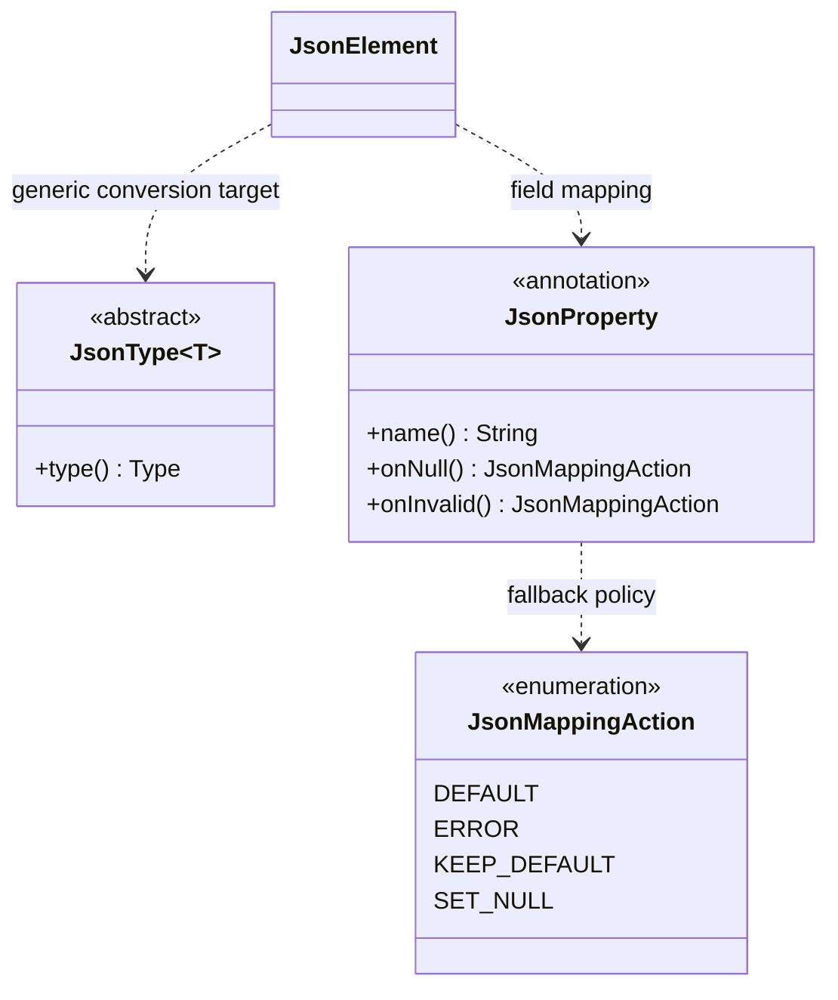
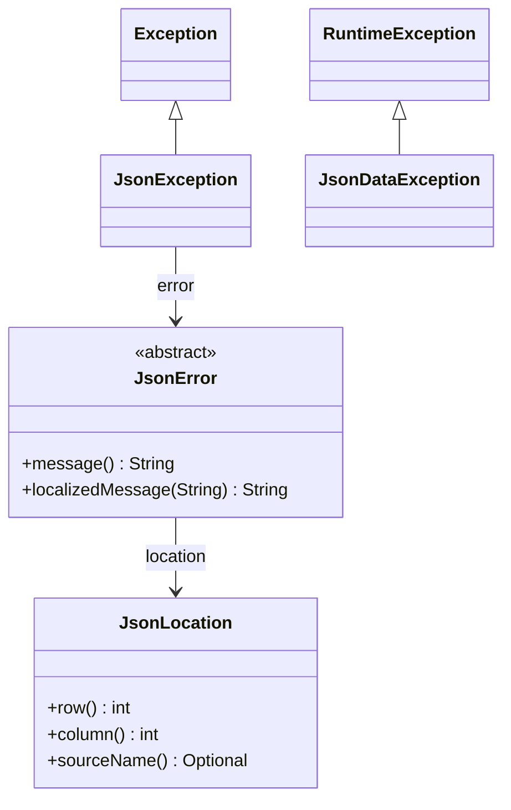
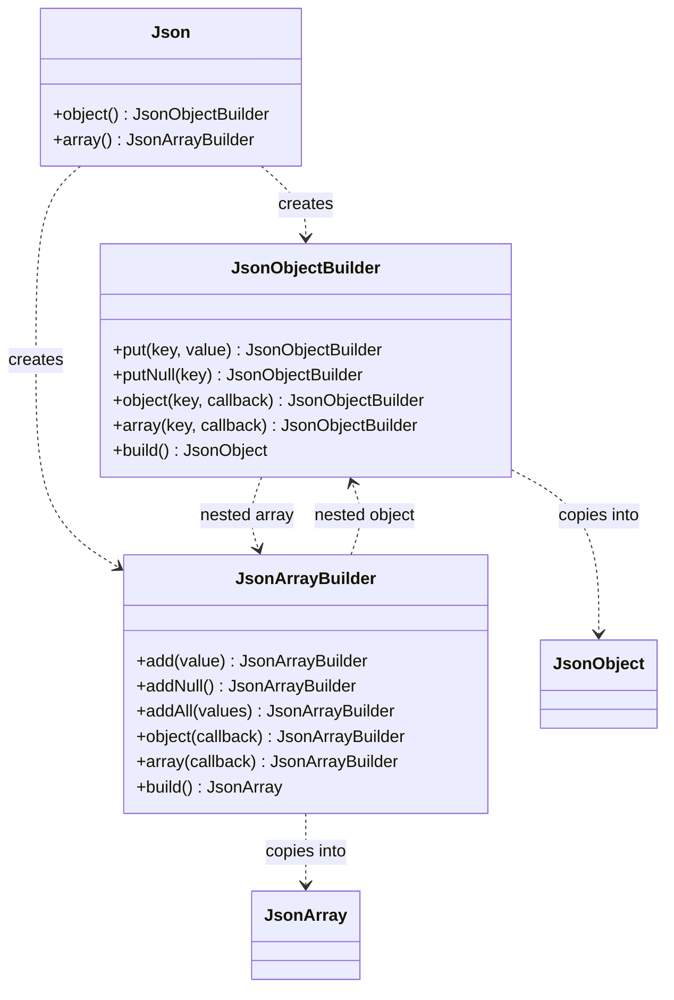

<!--
  Copyright (c) 2026 Ivan Kniazkov
-->
# A map of the public API

[Guide](README.md) · [Tree](tree.md) · [Mapping](java-mapping.md)

The public API lives in `com.kniazkov.json`. The diagrams are split by responsibility
so that you can read them without zooming out across the entire library.
Solid inheritance arrows point toward a base class; dashed arrows describe use.
Java collection and exception types are included where they explain a contract.

## The JSON tree

`JsonObject` implements `Map<String, JsonElement>`; `JsonArray` implements
`List<JsonElement>`. Their live/read-only view distinctions are described in
[collection behavior](tree.md#java-collection-behavior).

| Class | Create it | Role |
| --- | --- | --- |
| JsonElement | Obtain from parsing or a concrete node | Predicates, getters, strict getters, copying, equality and conversion |
| JsonContainer | Use JsonObject/JsonArray | Common container parent type |
| JsonObject | `new JsonObject()` | String-keyed members in insertion order |
| JsonArray | `new JsonArray()` | Ordered elements |
| JsonString | `new JsonString(text)` | String value |
| JsonBoolean | `of(boolean)`, `TRUE`, `FALSE` | Boolean value |
| JsonNull | `INSTANCE` | Explicit JSON null |

The abstract tree types are a shared API for the built-in nodes, not a custom-node
plug-in mechanism. Parent-aware implementation hooks are package-private.

## Numbers

Use the factory for routine construction. Explicit constructors also exist:
`JsonInteger(BigInteger)`, `JsonReal(BigDecimal)`, `JsonNaN()` and
`JsonInfinity(boolean negative)`. See [numbers](numbers.md) for exactness,
special values and conversion rules.

## Parsing and writing

| Entry point | Inputs / outputs |
| --- | --- |
| `Json.parse` | String, File, Reader or InputStream; overloads for mode, input metadata/charset and selected typed roots |
| `Json.serialize` | Java value or JSON tree → String, compact or indented |
| `JsonParser.parse` | String, Reader, InputStream or File → tree; settings belong to the instance |
| `JsonParser.parseString` | Static text parsing with optional mode and append-to-list warnings |
| `JsonParser.parseJavaObject` | Java application value → tree |
| `JsonSerializer.serialize` | Java value or tree → String, Writer, OutputStream or File |

Use a configured instance for advanced options rather than searching for a static
overload for every combination. Full defaults and ownership rules are in [I/O](io.md).

## Typed conversion and field policies

`JsonType<T>` captures a direct subclass's type argument.
`new JsonType<Map<String, Integer>>() {}` carries information that
`Map.class` cannot. `JsonProperty` applies to eligible fields;
`JsonMappingAction` determines the response to explicit null or invalid data.
See [Java mapping](java-mapping.md) for supported targets and policy validation.

## Diagnostics

JsonLocation is immutable and returned by diagnostics; it has no public constructor.
JsonException and JsonDataException accept a message/error and optionally a cause.
They represent different failure domains, not two levels of the same exception hierarchy.

### Public diagnostic subclasses

These names are nested in `JsonError` and can be tested with `instanceof`.
Their constructors are internal; consumers inspect diagnostics returned by the parser.
All extend JsonError directly except the numeric specializations listed below.

| Group | Types |
| --- | --- |
| Root, input and ending | ExpectedRoot, TrailingContent, InputFailure, UnexpectedEnd |
| Structure | MissingComma, MissingArrayElement, MissingClosingBracket, ExpectedElementAfterComma, ExpectedPairAfterComma, ExpectedKey, ExpectedSeparator, ExpectedElementAfterSeparator, UnexpectedToken |
| Strings/comments/characters | UnclosedString, IncorrectStringSequence, UnescapedLineSeparator, UnclosedComment, InvalidCharacter |
| Numeric base | IncorrectNumberFormat |
| Subclasses of IncorrectNumberFormat | ExpectedNumberAfterMinus, ExpectedNumberAfterPlus, ExpectedNumberAfterPoint, IncorrectExponentNotation, ExpectedHexDigit |

Some types describe recoverable warnings in EXTENDED; the same underlying problem
may be fatal in another mode. See [recovery](recovery.md) rather than assuming every
JsonError is a warning.

## What is intentionally absent from these diagrams?

Source, lexer tokens, parsing sessions, traversal frames and mapping helpers are
package-private implementation details. Application code uses the public parser,
tree and diagnostics instead. Generate [Javadoc](development.md) for full signatures.

## Fluent construction

Both builders have public no-argument constructors. Their callbacks receive a
fresh nested builder; `build()` returns an independent tree. See
[Builders](builders.md) for value types, null handling, ownership and failure behavior.
